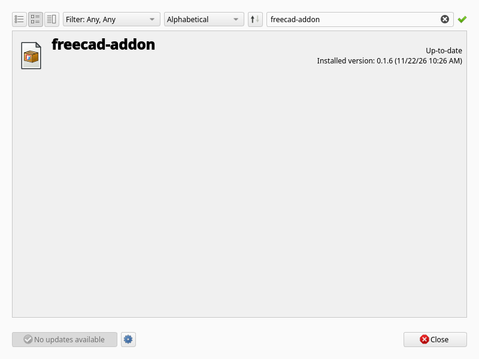
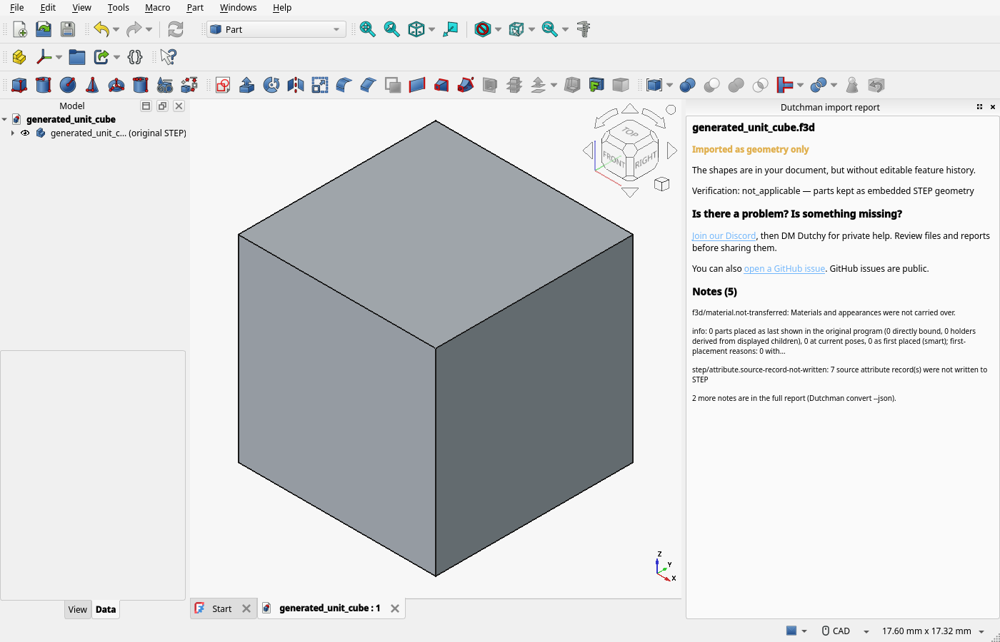
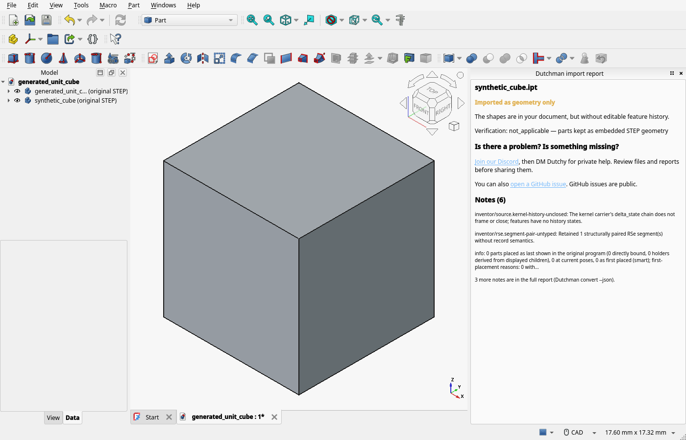
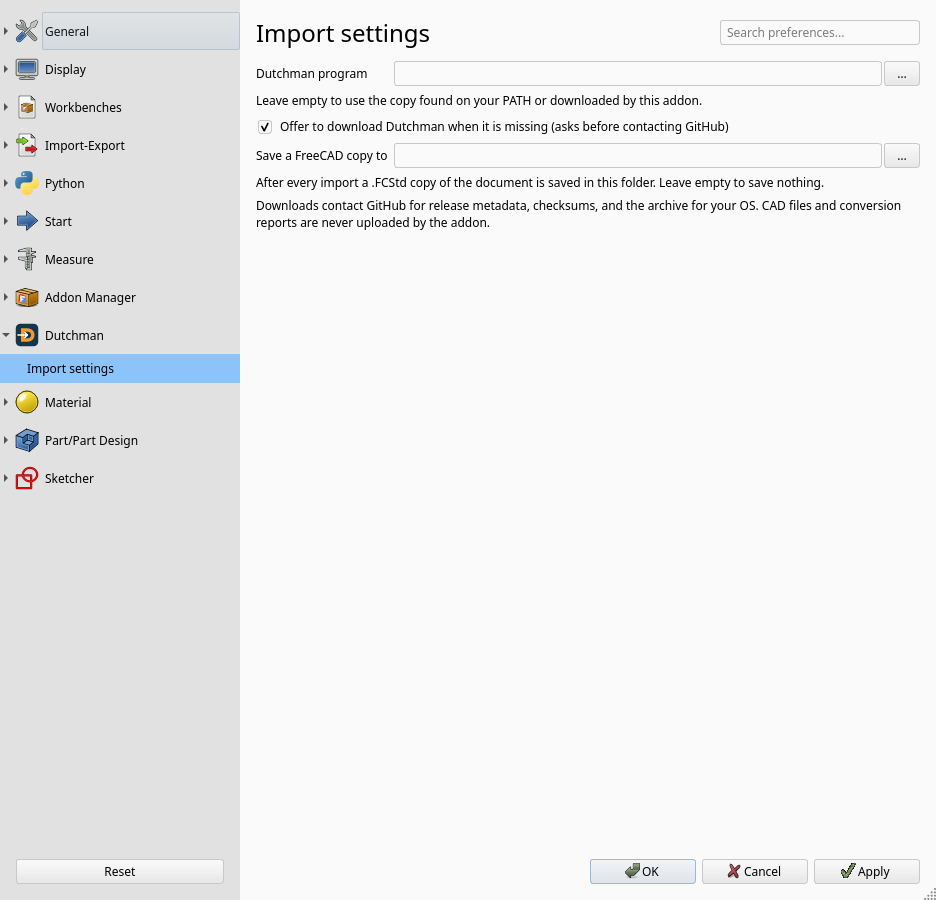

# Dutchman for FreeCAD

Import CAD files with [Dutchman](https://github.com/dutchman-cad/dutchman) and inspect
what survived conversion. This addon adds import filters and preferences without
adding a workbench. Requires FreeCAD 1.1 or later, Python 3.9 or later, and the
built-in Part, PartDesign, and Sketcher modules. Dutchman performs all conversion and generates the FreeCAD
rebuild macro; the addon executes that macro and displays its JSON report.

## Quick start

1. **Install the addon.** Open **Tools → Addon Manager → Preferences (Addon Manager
   Options)**, add the custom repository
   `https://github.com/dutchman-cad/freecad-addon` with branch `main`, then reopen the
   Addon Manager. The entry is listed under its repository name, **freecad-addon**
   (it becomes **Dutchman** once installed). Select it, click **Install**, then restart
   FreeCAD. The Addon Manager treats a `file://` address as a plain folder, so a local
   test needs a normal (non-bare) clone, not a bare repository. A folder installed this way
   is never updated by the Addon Manager; to test updates locally, serve the repository over
   HTTP so the installed copy has a real remote.
2. **Open a CAD file.** Use **File → Open** and choose a `Dutchman: …` file type, or
   **File → Import** to add the file to the current document.
3. **Let Dutchman install itself.** If Dutchman is not on your computer, the first import
   asks whether to download it (checksum-verified, with a progress window). Already
   have it? Cancel and set its path in **Edit → Preferences → Dutchman**.
4. **Read the report.** The **Dutchman import report** panel opens on the right and says what
   was imported, what was lost, and where to get help.

## Screenshots



The add-on installed from a custom repository in the Addon Manager.



A design opened with File > Open, with the import report beside it.



File > Import adds a second file to the open document.



The Dutchman page in Edit > Preferences.

## Installation details

The runtime package uses the modern `freecad/dutchman_freecad` namespace layout.
FreeCAD loads its package initializer and `init_gui.py`; no legacy startup files
or workbench class are needed. The manifest declares `other` content.

Alternatively, copy or clone this repository into a `Dutchman` directory inside FreeCAD's user
`Mod` directory, then restart FreeCAD. Find the user data directory by running
`App.getUserAppDataDir()` in FreeCAD's Python console; create `Mod/Dutchman` beneath
that directory. The repository includes `package.xml` for Addon Manager metadata.

Dutchman is found in this order: the `DUTCHMAN_BIN` environment variable, the path in
**Edit → Preferences → Dutchman**, `dutchman` on PATH, then the managed copy in
`Dutchman/bin` beneath FreeCAD's user data directory. An invalid explicit path produces
an error so configuration mistakes are visible.

When no copy is found, an interactive import offers to download one (disable the offer
with **Offer to download Dutchman when it is missing**; with it off, the error dialog
offers the preferences page instead). The offer always asks first. Downloads use the latest
public GitHub release for your OS and architecture. The addon requires `SHA256SUMS` or an
archive-specific `.sha256` asset and verifies the archive before installing its
executable; a missing or mismatched checksum stops installation, and Cancel in the
progress window aborts the transfer. Headless imports never prompt or download.
Release checksums provide integrity checking; they are supplied by the same upstream
release as the archive.

## Import and reports

Choose **File → Open** or **File → Import** and select a `Dutchman: …` filter.
Open creates a document named after the source file. Import inserts into the
selected document and supports undo. Supported extensions come from
`dutchman formats --json` at startup; restart FreeCAD after changing the executable
to refresh the filters. When Dutchman is unavailable, fallback filters include
Fusion (`f3d`, `f3z`), Inventor (`ipt`, `iam`), SOLIDWORKS (`sldprt`, `sldasm`),
CATIA (`CATPart`, `CATProduct`), and Rhino (`3dm`). Conversion availability depends
on the installed Dutchman release. Native FreeCAD formats, STEP, IGES, BREP, STL,
and OBJ keep their existing FreeCAD importers.

The **Dutchman import report** dock displays full history, partial history, or
geometry only; mapped/rebuilt/total feature counts; verification status and reason;
and conversion losses with documentation links when supplied. Failed imports also open an error dialog naming the file, so a failure cannot be
mistaken for a finished import, and the panel keeps the full error (links are clickable).
The help prompt links to Discord for a private DM to Dutchy, with public GitHub
issues as an alternative; opening a link does not send a file or report. Reports in console
mode go to `FreeCAD.Console`. A successful import does not imply complete history
or verified equivalence: read the verification and losses in the report.

Set **Save a FreeCAD copy to** to save a copy of each imported document.
An empty field disables copies. Existing filenames are preserved by adding a
numeric suffix. With File → Import, the saved copy includes the target document.
Conversion macros and their temporary directory are removed after execution.

Preferences are stored under
`User parameter:BaseApp/Preferences/Mod/Dutchman` using `BinaryPath`, `AutoDownload`,
and `OutputFolder`.

## Development and validation

Run the Python standard-library unit tests without FreeCAD or external services:

```sh
python3 -m unittest discover -s tests -p 'test_*.py' -v
```

The download tests start a local HTTP server with synthetic release assets.
They require permission to bind a loopback socket. No private CAD models or
credentials are used. The public synthetic fixture is a 10 mm cube.

With FreeCADCmd and Dutchman installed, run:

```sh
DUTCHMAN_BIN=/path/to/dutchman FreeCADCmd tests/freecad_import_test.py
```

This verifies open, insert, a solid body, approximately 1000 mm³ of volume, at
least one object, and a successful conversion report. The test exits the console
process with a nonzero status on failure. CI installs the official FreeCAD
AppImage and checksum-verified Dutchman release, runs unit and console tests,
and captures the GUI report under Xvfb as a PNG artifact. CI uses the AppImage's
console mode, equivalent to FreeCADCmd.

## License

Apache-2.0; see [LICENSE](LICENSE) and [NOTICE](NOTICE) for the public fixture credit.

## Privacy, support, and contribution

Read [PRIVACY.md](PRIVACY.md) for network requests, consent, and local storage.
Maintained by Dutchman CAD: [hello@dutchmancad.xyz](mailto:hello@dutchmancad.xyz).
Read [SECURITY.md](SECURITY.md) to report vulnerabilities. File ordinary issues at
https://github.com/dutchman-cad/freecad-addon/issues and follow
[CONTRIBUTING.md](CONTRIBUTING.md) for synthetic reproductions and contributions.
The Addon Manager's user overview is [Overview.md](Resources/Documents/Overview.md).

Index submission requires a public repository at least 30 days old, community
feedback, and review of compatibility and functionality. The initial release
is not yet submitted to the Addon Index.
